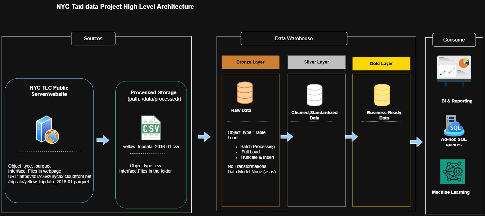

# NYC Taxi Data Engineering Project

## Project Overview & Motivation

Urban mobility systems generate vast volumes of raw transactional trip data that contain valuable operational and economic indicators. However, raw public transit datasets frequently suffer from data quality issues, including missing fields, zero-distance anomalies, corrupted timestamps, negative fares, and prohibitive file formats for ad-hoc exploration.

So,under this project,creating simple automated data engineering pipeline ,which designed to:

      1.Establish an automated, repeatable ETL (Extract, Transform, Load) workflow for large-scale public mobility datasets.
      
      2. Cleanse corrupt or inconsistent telemetry records to ensure data integrity for downstream analytics.
      
      3.Compute standardized operational Key Performance Indicators (KPIs) such as trip duration, driver tipping behavior, and average transit speed.
      
      4. Validate transformation logic and data contracts using automated unit tests with pytest

# What Data is Ingested

      Source: Official NYC Taxi and Limousine Commission (TLC) trip record dataset (Yellow Taxi monthly batches).
      
      Format: Compressed Apache Parquet files downloaded remotely and converted to CSV.

Key Fields:

      Timestamps: tpep_pickup_datetime, tpep_dropoff_datetime
      
      Trip metrics: trip_distance, passenger_count
      
      Financials: fare_amount, tip_amount, total_amount

# Data Architecture

The project follows the Medallion Architecture, consisting of three layers:




**Bronze Layer** : Raw Data Ingestion

          -Imports source data from NYC Taxi data files into SQL Server,after extracting and ingesting parquet files as csv files into local storage.
          
          -Preserves the original source data for traceability and further processing.
          
          -Provides the foundation for downstream data transformations.


---
# Technologies and Resources

The project uses the following tools and resources, with the core software tools available free of charge.


| Tool or Resource                       | Purpose                                                                      |
|----------------------------------------|------------------------------------------------------------------------------|
|SQL Server Express                      |	Database engine for storing and processing warehouse data               |
|SQL Server Management Studio (SSMS)     |	Interface for writing and executing SQL scripts                         |
|Python                                  |      Extract row data from NYC website and convert to processed csv          |
|GitHub                                  |	Source control, version management, and project documentation           |
|Draw.io                                 |	Creating architecture diagrams, data flows, and data models             |
|Notion                                  |	Organizing project phases, tasks, and implementation notes              |
|Dataset                                 |      NYC Taxi source files in CSV format, stored in the datasets directory   |
|Project Documentation                   |      Reference for the project's implementation steps                        |

---

## 📂 Repository Structure
              ```
              nyc-taxi-data-engineering-project/
              │
              ├── data/
              │   ├── exports/                 # Analytics exports data from datawarehouse
              │   └── processed/               # NYC taxi data .csv format
              │   └── row/                     # NYC taxi data .parquest format
              │
              |
              ├── docs/                           # Project documentation
              │   ├── data_architecture.jpg       # Data warehouse architecture
              │   ├── data_flow.jpg               # Data flow diagrams
              │   ├── Integration_model.jpg       
              │   ├── star_schema.jpg             
              │   ├── first_project.drawio       #all diagrams draw using draw.io
              │  
              │
              ├── scripts/                        # SQL scripts
              │   ├── bronze/
              │   │   ├── ddl_bronze.sql          # Create Bronze tables
              │   │   └── proc_load_bronze.sql    # Load raw source data
              |   ├── silver/
              │   │   ├── ddl_silver.sql          # Create Silver tables
              │   │   └── proc_load_silver.sql    # Clean and transform data
              │   │
              │   └── gold/
              │       └── ddl_gold.sql            # Create analytical data models
              │
              |── src/ 
              |     ├── exporters/
              |     |      ├── export_query_to_csv.py
              |     |
              |     ├── notebooks
              |          ├── injest_data.ipynb
              |          ├── transform.py
              |          ├── sample_file_generate_for_github.ipynb            
              ├── test/                           # Data quality and validation scripts
              │    ├── pytest.ipynb
              |    ├── test_bronze_ingestion.sql
              |    ├── test_taxi_pipeline.py      
              |     ├── Results/
              |──.gitignore
              ├── README.md                       # Project overview and instructions
              ├── LICENSE                         # MIT Project license
              ```

 ## License

This project is licensed under the MIT License. See the LICENSE file for details.

👩‍💻 About Me

Hi, I'm **Nadeeka Kiringoda**, a PhD researcher and Data Engineering professional with **7+ years of experience** in building reliable data pipelines, designing scalable data architectures, and developing data-driven solutions. I'm passionate about leveraging data engineering, analytics, and AI to solve real-world problems.
Thank you for visiting my repository! ⭐

### Let's stay in touch!:
[](https://www.linkedin.com/in/nadeeka-kiringoda)

